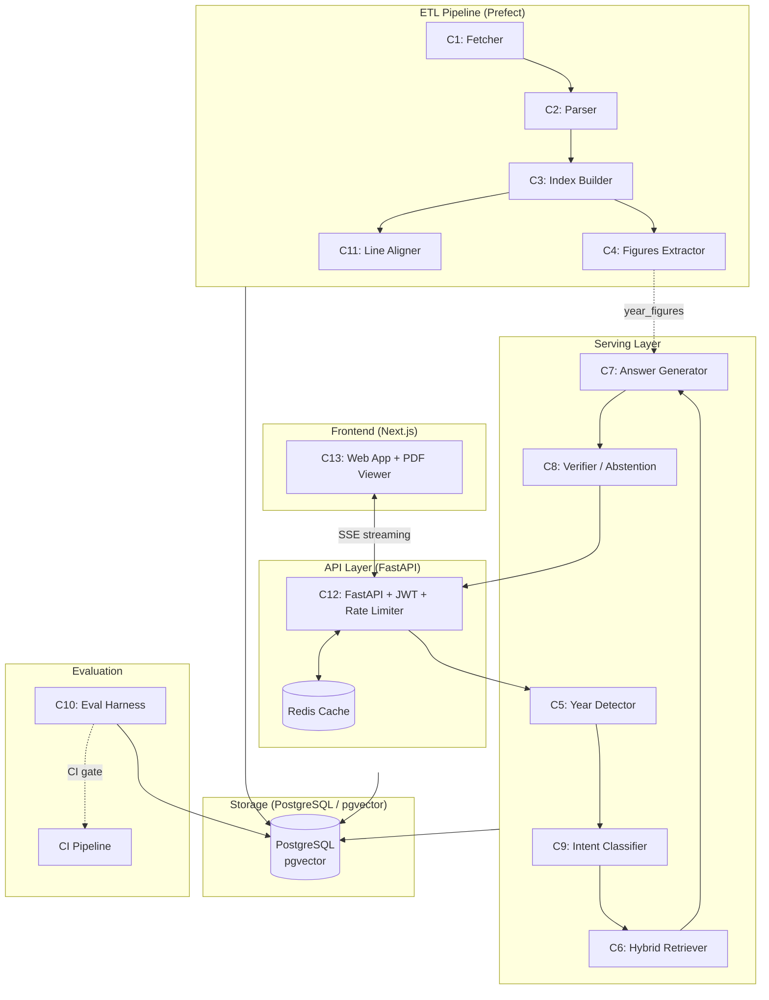
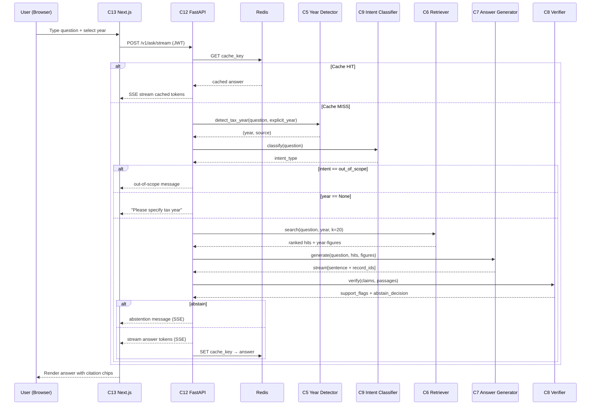
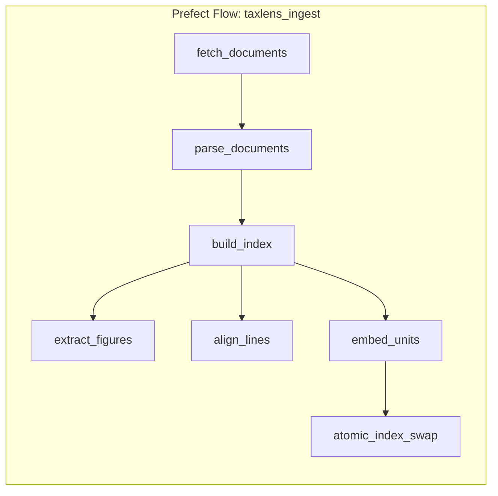
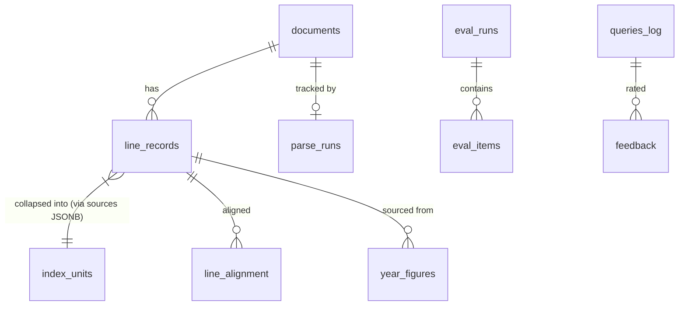

# TaxLens — Technical Design Document

## Overview

TaxLens is a tax-year-aware retrieval-augmented question-answering system over official IRS documents. Its defining characteristic is treating **tax year as a first-class constraint** at every stage of the pipeline: ingestion, indexing, retrieval, generation, verification, and serving. Naive RAG systems retrieve the most semantically similar passage regardless of year, producing confident answers that silently cite the wrong year's figures. TaxLens eliminates this class of error by construction.

### Core Design Principles

1. **Year-first filtering** — every retrieval operation gates on a validity interval before ranking.
2. **Structured figures over free text** — year-varying dollar amounts are stored in a typed table and never inferred from prose embeddings.
3. **Abstain rather than hallucinate** — a dedicated verifier and abstention classifier refuse to return unsupported claims.
4. **Atomic index swaps** — the serving index transitions from old to new in a single transaction; no query ever reads a partially rebuilt state.
5. **Full provenance** — every sentence in an answer cites the exact IRS line, page, and bounding box it came from.

### Scope

- **MVP corpus**: Form 1040 (schedules 1–3, A, B), Form 1040 general instructions, Schedule A instructions, Publication 17 — tax years 2021–2024 (36 PDFs).
- **Full corpus**: 230+ forms, instructions, publications for tax years 2019–2025 (~9,000 pages). TY2025 is held out from training and tuning.
- **Initial language model**: OpenAI GPT-4o for answer generation (swappable with vLLM + open-weight model behind the same interface).

---

## Architecture

### High-Level System Diagram



### Component Inventory

| ID  | Name                | Subsystem  | Primary Responsibility |
|-----|---------------------|------------|------------------------|
| C1  | Fetcher             | ETL        | Download, hash, upsert IRS PDFs |
| C2  | Parser              | ETL        | PDF → typed Line_Records with bounding boxes |
| C3  | Index Builder       | ETL        | Line_Records → validity-interval Index_Units + HNSW embeddings |
| C4  | Figures Extractor   | ETL        | Margin text → year_figures table |
| C5  | Year Detector       | Serving    | Question → (tax_year, source) |
| C6  | Hybrid Retriever    | Serving    | (question, year) → ranked Index_Units |
| C7  | Answer Generator    | Serving    | (question, passages, figures) → cited JSON answer |
| C8  | Verifier/Abstainer  | Serving    | claims + passages → support flags + abstention decision |
| C9  | Intent Classifier   | Serving    | question → one of 7 intent types |
| C10 | Eval Harness        | Eval       | Benchmark execution, metric aggregation, CI gate |
| C11 | Line Aligner        | ETL        | Cross-year Canonical_Line_ID assignment |
| C12 | FastAPI Backend     | API        | REST + SSE endpoints, JWT auth, rate limiting, Redis cache |
| C13 | Next.js Frontend    | Frontend   | Chat UI, PDF citation viewer, year selector, feedback |

### Request Lifecycle (Serving Path)



### ETL Pipeline (Prefect DAG)



Each Prefect task is independently retryable. The `atomic_index_swap` task promotes the newly built `index_units` set into the serving slot in a single PostgreSQL transaction (see Atomic Index Swap section below).

---

## Components and Interfaces

### C1 — Fetcher

**Module**: `taxlens/ingest/fetch.py`, `taxlens/ingest/corpus.py`

**Interface**:
```python
def download(url: str, dest: Path, session: requests.Session, retries: int = 3) -> None
def sha256_of(path: Path) -> str  # streaming 1 MiB chunks
def manifest_row(doc: CorpusDoc, path: Path) -> dict
def main() -> int  # CLI entry point
```

**Key Design Decisions**:
- URLs are derived exclusively from `IRS_PRIOR_BASE = "https://www.irs.gov/pub/irs-prior"` — no fallback to the current-forms folder.
- Write-then-rename (`file.part` → `file`) prevents partial files on crash.
- SHA-256 is checked before any network call; a hash match skips the download entirely.
- HTTP 404 is handled as a per-document failure, not a run-aborting error; the run continues and failures are reported at the end.
- Retry uses exponential back-off: waits of 2 s and 4 s before the third attempt, then raises.

**Upsert SQL**: inserts or updates the `documents` table; only updates the row when `sha256` changes (prevents spurious `fetched_at` updates for unchanged files).

---

### C2 — Parser

**Module**: `taxlens/ingest/parse.py`, `taxlens/ingest/run_parser.py`

**Two parsing strategies**:

| Document type | Strategy | Output record types |
|--------------|----------|---------------------|
| Form (1040, schedules) | Line-number column detection + two-column split | `form_line`, `form_text` |
| Instructions, Publication | Recursive XY-cut layout analysis | `section` |

**Form parsing algorithm**:
1. Extract words with font metadata using pdfplumber at x_tolerance=1.5, y_tolerance=2.
2. Group words into visual rows by shared baseline (tolerance 2.5 pt).
3. Identify the line-number column: the leftmost x-coordinate where tokens matching `\d{1,2}[a-z]?` are immediately followed by capitalized text, appearing in ≥ 2 rows.
4. Split each row into margin side (x ≤ num_x − 3) and main area.
5. Parse line items: numeric token at the number column → new `_Item`; letter sub-label → sub-item of current numeric; continuation row within 6 pt below → extend current item; otherwise → `form_text`.
6. Strip leader tokens (dots, ellipses, bullets, arrows) and repeated box labels.

**Prose parsing algorithm (recursive XY-cut)**:
1. Detect vertical gutters (empty horizontal spans ≥ 8 pt wide) to split columns.
2. Within each column, detect horizontal gaps (empty vertical spans ≥ 4.5 pt tall) to split blocks.
3. Merge adjacent bands that share the same column gutter (handles full-width paragraphs above two-column sections).
4. Read blocks left-column-first, top-to-bottom within each column.
5. Detect bold-sans headings by font name and size; maintain a heading path stack.
6. Chunk body text at sentence boundaries up to 1,200 characters.

**Skip logic**: a document is skipped when both its file SHA-256 and `PARSER_VERSION` match the `parse_runs` record, making re-runs cheap after code changes to the parser.

**Atomicity**: each document's records are deleted and re-inserted in a single `conn.transaction()`, so the database never contains partial results.

---

### C3 — Index Builder

**Module**: `taxlens/index/build.py`, `taxlens/index/intervals.py`

**Validity-interval construction** (`build_units`):
1. Group records by `(form_code, record_type, line_label, normalize(text))`.
2. Within each group, sort by `tax_year` and find contiguous runs.
3. Each contiguous run → one `Unit` with `valid_from = run[0]`, `valid_to = run[-1]`.
4. Store `sources: dict[int, record_id]` mapping every year in the run to its source record.

**Normalization** (`normalize`): NFKC Unicode normalization → smart-quote substitution (curly → straight) → whitespace collapse. This ensures cosmetic differences (different PDF encodings of the same IRS text) do not split units.

**Embedding**: each unit's text is embedded using the fine-tuned bi-encoder (sentence-transformers API). Embeddings are stored in the `embedding` column (`vector(768)`) of `index_units`. An HNSW index (`CREATE INDEX USING hnsw`) is built over this column.

**Atomic rebuild**:
```sql
BEGIN;
TRUNCATE index_units RESTART IDENTITY;
INSERT INTO index_units (...) VALUES (...), (...), ...;
COMMIT;
```
The TRUNCATE + INSERT happen inside a single transaction. Concurrent read queries see either the old complete index or the new complete index, never a partial state.

**HNSW index parameters**: `m=16`, `ef_construction=200`. At query time, `SET hnsw.ef_search = 200` to balance recall vs latency.

---

### C4 — Figures Extractor

**Module**: `taxlens/index/figures.py`

**Algorithm**: scans Form 1040 `form_text` records for the string "Standard Deduction for"; applies three regex patterns to extract dollar amounts keyed by filing status. Each extracted `Figure` carries `source_ref` (the `record_id`) and `source_text` (the matched substring) for full provenance.

**Extensibility**: the `FILING_STATUS_PATTERNS` dict is the only code to change when adding a new figure type. Future extractors (e.g., contribution limits, AMT exemptions) follow the same `Figure` dataclass contract.

**Table key**: `(parameter, filing_status, tax_year)` PRIMARY KEY ensures one authoritative value per combination.

---

### C5 — Year Detector

**Module**: `taxlens/retrieve/yeardetect.py`

**Detection priority** (first match wins):
1. `explicit` parameter (from UI year selector) → `source = "explicit"`
2. Filing-year patterns (e.g., "filing in 2024", "2024 filing season") → `year - 1`, `source = "filing_year"`
3. Tax-year patterns (e.g., "tax year 2023", "for 2023", "my 2023 return") → `source = "tax_year"`
4. Single unambiguous year anywhere in text → `source = "tax_year"`
5. Relative phrases ("last year", "this year") resolved against `today` → `source = "relative"`
6. No year signal → `year = None`, `source = "none"`

**Confidence score** (for abstention feature): `explicit = 1.0`, `tax_year/filing_year = 0.9`, `relative = 0.75`, `default = 0.5`, `none = 0.0`.

---

### C6 — Hybrid Retriever

**Module**: `taxlens/retrieve/search.py` (current BM25 baseline), extended with dense retrieval.

**Two-stage retrieval**:

#### Stage 1: Hybrid retrieval

```
candidates = year_filter(index_units, year)      # SQL: valid_from <= year <= valid_to
bm25_scores = BM25.scores(query, candidates)
dense_scores = bi_encoder.encode(query) · embeddings[candidates]   # cosine similarity
rrf_score[i] = 1/(k + rank_bm25[i]) + 1/(k + rank_dense[i])       # RRF, k=60
```

Year filtering is applied before ranking so no off-year unit can appear in results.

#### HNSW year-filter strategy

pgvector's HNSW index does not natively support pre-filtering by arbitrary predicates; applying a `WHERE valid_from <= $year AND $year <= valid_to` filter post-ANN-search degrades recall when many units are from other years.

**Solution — iterative over-fetch**:
```python
ef = initial_fetch_size   # start at 4 * k (e.g., 80 for k=20)
while True:
    candidates = hnsw_search(query_vec, ef)              # raw ANN, no filter
    filtered = [c for c in candidates if c.applies_to(year)]
    if len(filtered) >= k or ef >= max_ef:
        return filtered[:k]
    ef = min(ef * 2, max_ef)                             # double and retry
```

`max_ef = 500`. This guarantees we always return k year-valid results (or all available if fewer than k exist) without degrading the dense recall.

#### Stage 2: Line-label structured lookup

When the query matches `\bline\s+(\d{1,2}[a-z]?)\b`, a direct label lookup retrieves the matching `form_line` unit for the requested year and injects it at rank 0 (above all BM25/dense results).

#### Stage 3: Cross-encoder re-ranking

The top-20 hybrid results are re-ranked by a fine-tuned ModernBERT cross-encoder:
```python
scores = cross_encoder.predict([(query, hit.text) for hit in top20])
reranked = sorted(zip(top20, scores), key=lambda x: -x[1])[:k]
```

#### Cross-year hard negatives for bi-encoder fine-tuning

Training data construction for ~40,000 synthetic questions:
1. For each (question, positive_unit) pair, find units from **adjacent years** (year ± 1) that have the same `form_code` + `line_label` but different normalized text — these are **cross-year hard negatives**.
2. Also include BM25 top-k misses from the same year as **in-year hard negatives**.
3. Training triple: `(query, positive, [cross_year_neg, in_year_neg, random_neg])`.

This forces the bi-encoder to learn that semantic similarity alone is insufficient — the year dimension must encode differently.

---

### C7 — Answer Generator

**Module**: `taxlens/answer/generate.py` (to be created)

**Input**: question, top-k retrieved hits, year-specific figures from `year_figures`.

**Prompt structure**:
```
SYSTEM: You are TaxLens, a tax-year-aware assistant. ...
        Today's context: Tax Year {year}.
        Figures for this year: {figures_json}
        Passages (cite by record_id):
        [{record_id}] {heading_path}: {text}
        ...
USER: {question}
ASSISTANT: (structured JSON)
```

**Output schema**:
```json
{
  "sentences": [
    {"text": "...", "record_ids": [12345, 12346]},
    ...
  ],
  "disclaimer": "TaxLens provides information from IRS publications for educational purposes only and is not tax advice."
}
```

**Attribution retry loop**: if a sentence's text is not supported by the cited passage (checked by the verifier), the generator retries up to `MAX_ATTRIBUTION_RETRIES = 3` times. Sentences that fail attribution after all retries are omitted from the final answer.

**Streaming**: the generator yields sentence objects one at a time. FastAPI passes each to the SSE stream immediately, achieving low TTFT.

---

### C8 — Verifier and Abstention Classifier

**Module**: `taxlens/verify/verifier.py`, `taxlens/verify/abstain.py` (to be created)

#### Claim splitter
Splits each generated sentence into atomic claims using a small prompt ("Extract all distinct factual claims from this sentence as a JSON list").

#### NLI entailment check
For each claim, the ModernBERT cross-encoder (same model as the re-ranker, dual-purpose) scores `(claim, each_passage)` as entail/neutral/contradict. A claim is **supported** if at least one passage scores "entail" above threshold `τ_nli = 0.7`.

#### Abstention classifier

**Features** (LightGBM binary classifier):
- `max_retrieval_score`: highest cross-encoder score in the candidate set
- `mean_retrieval_score`: mean of top-5 cross-encoder scores
- `year_detection_confidence`: from Year Detector source mapping
- `intent_type_encoded`: one-hot over 7 intent types
- `n_supported_claims`: fraction of claims with NLI support
- `n_passages_for_year`: count of index units valid for the detected year

**Decision**: `abstain = classifier.predict_proba(features)[1] > τ_abstain`

`τ_abstain` is tuned on the eval set to achieve AUROC ≥ 0.94. The selective-accuracy curve (accuracy vs. fraction answered as `τ_abstain` varies) is emitted as a plot in eval output.

---

### C9 — Intent Classifier

**Module**: `taxlens/intent/classify.py` (to be created)

**Seven intent types**:
| Intent | Description |
|--------|-------------|
| `figure_lookup` | User wants a specific dollar amount (standard deduction, contribution limit) |
| `rule_or_eligibility` | User wants to know if they qualify for something |
| `form_navigation` | User wants to know which line/form to use |
| `procedure_or_computation` | User wants step-by-step instructions |
| `definition` | User wants a term defined |
| `cross_year_change` | User asks how something changed between years |
| `out_of_scope` | Not about IRS / outside corpus |

**Model selection**: three candidates evaluated on the labeled benchmark — TF-IDF + logistic regression, XGBoost, fine-tuned DistilBERT. The highest macro-F1 model is deployed. Current expectation: fine-tuned DistilBERT.

**Interface**:
```python
def classify(question: str) -> IntentResult:
    ...

@dataclass
class IntentResult:
    intent: str          # one of the 7 types
    confidence: float    # [0.0, 1.0]
```

---

### C10 — Evaluation Harness

**Module**: `taxlens/eval/retrieval_eval.py`, `taxlens/eval/run_retrieval.py`, `taxlens/eval/parse_audit.py`

**Benchmark format** (`eval/benchmark/*.jsonl`): each line is a JSON object with `id`, `topic`, `tax_year`, `question`, `gold_any` (list of acceptable answer strings), `gold_record_ids` (for retrieval eval), `intent_type`.

**Metrics computed per run**:
- `recall@5`, `hit@1`, `wrong_year@1` (retrieval)
- `year_detection_accuracy`
- `answer_correctness` (human graded via rubric)
- `citation_precision`
- `unsupported_claim_rate`
- All with 95% bootstrap confidence intervals (2,000 bootstrap samples)

**McNemar test**: `mcnemar_exact(system_a_hits, system_b_hits)` — exact two-sided p-value for pairwise binary metric comparison between system versions.

**CI gate thresholds**:
```python
GATE_RULES = [
    ("answer_correctness", "delta", -0.02),   # fail if drops > 2pp vs previous run
    ("wrong_year_at_1", "absolute", 0.03),    # fail if exceeds 3%
]
```

**DB persistence**: every run writes one `eval_runs` row (aggregate metrics as JSONB) and one `eval_items` row per question.

---

### C11 — Line Aligner

**Module**: `taxlens/index/align.py` (to be created)

**Similarity score** for a candidate pair (line A from year Y, line B from year Y+1):

```
sim = 0.4 * cosine(embed(A.text), embed(B.text))
    + 0.3 * (1 - normalized_edit_distance(A.text, B.text))
    + 0.2 * (1 - abs(A.rel_position - B.rel_position))
    + 0.1 * (1 if same_section else 0)
```

**Hungarian algorithm**: `scipy.optimize.linear_sum_assignment(-sim_matrix)` for globally optimal one-to-one matching. Pairs below a confidence threshold `τ_align = 0.55` are recorded as unmatched.

**Output table**: `line_alignment` (see Data Models).

---

### C12 — FastAPI Backend

**Module**: `taxlens/api/` (to be created)

#### Endpoints

| Method | Path | Auth | Notes |
|--------|------|------|-------|
| POST | /v1/ask | JWT | Synchronous; waits for complete answer |
| POST | /v1/ask/stream | JWT | Server-sent events; streams sentence tokens |
| GET | /v1/documents/{id} | JWT | Returns document metadata + PDF URL |
| GET | /v1/history | JWT | Paginated query history for the user |
| POST | /v1/feedback | JWT | Records thumbs up/down + comment |
| GET | /health | None | Returns `{"status": "ok"}` |

#### JWT authentication

```python
# FastAPI dependency
async def get_current_user(token: str = Depends(oauth2_scheme)) -> User:
    payload = jwt.decode(token, SECRET_KEY, algorithms=["HS256"])
    return User(id=payload["sub"])
```

All non-health endpoints declare `Depends(get_current_user)`.

#### Rate limiting

Using `slowapi` (Redis-backed):
```python
limiter = Limiter(key_func=get_remote_address)
app.state.limiter = limiter

@app.post("/v1/ask")
@limiter.limit("20/minute")
async def ask(...): ...

@app.post("/v1/ask/stream")
@limiter.limit("20/minute")
async def ask_stream(...): ...
```

#### Redis cache key design

```python
def cache_key(question: str, tax_year: int, index_version: str) -> str:
    normalized_q = re.sub(r"\s+", " ", question.strip().lower())
    payload = f"{normalized_q}|{tax_year}|{index_version}"
    return "taxlens:answer:" + hashlib.sha256(payload.encode()).hexdigest()
```

`index_version` is a string (e.g., a timestamp or content hash of `index_units`) stored in a Redis key `taxlens:index_version`. It is updated atomically when the ETL pipeline completes an index swap, automatically invalidating all cached answers from the old index.

Cache TTL: 24 hours. Cache entries are compressed (zlib level 6) before storage.

#### SSE streaming

```python
@app.post("/v1/ask/stream")
async def ask_stream(req: AskRequest, user=Depends(get_current_user)):
    async def event_generator():
        async for sentence in generate_answer_stream(req.question, req.tax_year):
            yield f"data: {sentence.model_dump_json()}\n\n"
        yield "data: [DONE]\n\n"
    return StreamingResponse(event_generator(), media_type="text/event-stream")
```

#### OpenTelemetry tracing

Every request gets a root span. Child spans:
```
taxlens.request
  ├── taxlens.cache_lookup
  ├── taxlens.year_detect
  ├── taxlens.intent_classify
  ├── taxlens.retrieval
  │     ├── taxlens.bm25_search
  │     ├── taxlens.dense_search
  │     └── taxlens.rerank
  ├── taxlens.answer_generate
  └── taxlens.verify
```

Span attributes: `tax_year`, `intent_type`, `retrieval_k`, `cache_hit`, `abstained`, `answer_sentence_count`.

---

### C13 — Next.js Frontend

**Module**: `frontend/` (to be created)

#### Key UI components

- **ChatWindow**: renders conversation history; streams incoming SSE tokens into the current assistant message.
- **YearSelector**: dropdown populated with corpus years; sets `sessionStorage["selectedYear"]`; shows the selected year prominently next to the input.
- **CitationChip**: each sentence in an answer renders inline numbered chips `[1]`, `[2]`. Clicking opens the PDF viewer.
- **PDFViewer**: renders the source PDF using `pdfjs-dist`; highlights the cited bounding box using a canvas overlay. The `boxes` coordinates from the API response drive the highlight geometry.
- **FeedbackBar**: thumbs-up / thumbs-down + optional text comment; calls `POST /v1/feedback`.
- **HistoryPanel**: collapsible sidebar listing past questions; populated from `GET /v1/history`.

#### SSE consumption

```typescript
const streamAnswer = async (question: string, year: number) => {
  const res = await fetch("/v1/ask/stream", {
    method: "POST",
    headers: { Authorization: `Bearer ${token}`, "Content-Type": "application/json" },
    body: JSON.stringify({ question, tax_year: year }),
  });
  const reader = res.body!.getReader();
  const decoder = new TextDecoder();
  for await (const chunk of streamChunks(reader, decoder)) {
    if (chunk === "[DONE]") break;
    const sentence = JSON.parse(chunk);
    appendSentence(sentence);  // updates React state
  }
};
```

---

## Data Models

### PostgreSQL Schema (complete)

```sql
-- Extension
CREATE EXTENSION IF NOT EXISTS vector;

-- ── documents ──────────────────────────────────────────────────────────────
CREATE TABLE documents (
    doc_id      TEXT PRIMARY KEY,               -- 'f1040-2023'
    form_code   TEXT        NOT NULL,           -- 'f1040'
    doc_type    TEXT        NOT NULL CHECK (doc_type IN ('form','instructions','publication')),
    title       TEXT        NOT NULL,
    tax_year    INT         NOT NULL CHECK (tax_year BETWEEN 2000 AND 2100),
    source_url  TEXT        NOT NULL,
    local_path  TEXT        NOT NULL,
    sha256      CHAR(64)    NOT NULL,
    size_bytes  BIGINT      NOT NULL,
    fetched_at  TIMESTAMPTZ NOT NULL DEFAULT now(),
    UNIQUE (form_code, tax_year)
);
CREATE INDEX documents_tax_year_idx ON documents (tax_year);

-- ── parse_runs ─────────────────────────────────────────────────────────────
CREATE TABLE parse_runs (
    doc_id         TEXT PRIMARY KEY REFERENCES documents ON DELETE CASCADE,
    sha256         CHAR(64)    NOT NULL,
    parser_version TEXT        NOT NULL,
    record_count   INT         NOT NULL,
    seconds        REAL        NOT NULL,
    parsed_at      TIMESTAMPTZ NOT NULL DEFAULT now()
);

-- ── line_records ───────────────────────────────────────────────────────────
CREATE TABLE line_records (
    record_id    BIGSERIAL PRIMARY KEY,
    doc_id       TEXT  NOT NULL REFERENCES documents ON DELETE CASCADE,
    seq          INT   NOT NULL,
    record_type  TEXT  NOT NULL CHECK (record_type IN ('form_line','form_text','section')),
    line_label   TEXT,
    heading_path TEXT,
    text         TEXT  NOT NULL,
    page         INT   NOT NULL,
    boxes        JSONB NOT NULL,   -- [{page,x0,top,x1,bottom}, ...]
    UNIQUE (doc_id, seq)
);
CREATE INDEX line_records_doc_label_idx ON line_records (doc_id, line_label);

-- ── index_units ────────────────────────────────────────────────────────────
CREATE TABLE index_units (
    unit_id      BIGSERIAL PRIMARY KEY,
    form_code    TEXT  NOT NULL,
    record_type  TEXT  NOT NULL,
    line_label   TEXT,
    heading_path TEXT,
    text         TEXT  NOT NULL,
    valid_from   INT   NOT NULL,
    valid_to     INT   NOT NULL CHECK (valid_to >= valid_from),
    sources      JSONB NOT NULL,   -- {"2023": record_id, ...}
    embedding    vector(768)        -- NULL until embed step runs
);
CREATE INDEX index_units_years_idx ON index_units (valid_from, valid_to);
CREATE INDEX index_units_hnsw_idx  ON index_units
    USING hnsw (embedding vector_cosine_ops)
    WITH (m = 16, ef_construction = 200);

-- ── line_alignment ─────────────────────────────────────────────────────────
CREATE TABLE line_alignment (
    alignment_id       BIGSERIAL PRIMARY KEY,
    canonical_line_id  TEXT        NOT NULL,   -- stable cross-year ID
    form_code          TEXT        NOT NULL,
    record_id_a        BIGINT      NOT NULL REFERENCES line_records ON DELETE CASCADE,
    record_id_b        BIGINT      NOT NULL REFERENCES line_records ON DELETE CASCADE,
    year_a             INT         NOT NULL,
    year_b             INT         NOT NULL,
    similarity_score   REAL        NOT NULL,
    match_type         TEXT        NOT NULL CHECK (match_type IN ('matched','unmatched')),
    UNIQUE (record_id_a, record_id_b)
);
CREATE INDEX line_alignment_canonical_idx ON line_alignment (canonical_line_id);

-- ── year_figures ───────────────────────────────────────────────────────────
CREATE TABLE year_figures (
    parameter        TEXT   NOT NULL,
    filing_status    TEXT   NOT NULL,
    tax_year         INT    NOT NULL,
    value            BIGINT NOT NULL,
    source_record_id BIGINT REFERENCES line_records ON DELETE SET NULL,
    source_text      TEXT   NOT NULL,
    PRIMARY KEY (parameter, filing_status, tax_year)
);

-- ── queries_log ────────────────────────────────────────────────────────────
CREATE TABLE queries_log (
    query_id    BIGSERIAL PRIMARY KEY,
    user_id     TEXT        NOT NULL,
    question    TEXT        NOT NULL,
    tax_year    INT,
    intent_type TEXT,
    cache_hit   BOOLEAN     NOT NULL DEFAULT FALSE,
    abstained   BOOLEAN     NOT NULL DEFAULT FALSE,
    latency_ms  INT,
    created_at  TIMESTAMPTZ NOT NULL DEFAULT now()
);
CREATE INDEX queries_log_user_idx ON queries_log (user_id, created_at DESC);

-- ── feedback ───────────────────────────────────────────────────────────────
CREATE TABLE feedback (
    feedback_id BIGSERIAL PRIMARY KEY,
    query_id    BIGINT      REFERENCES queries_log ON DELETE SET NULL,
    user_id     TEXT        NOT NULL,
    rating      SMALLINT    NOT NULL CHECK (rating IN (-1, 1)),   -- -1=down, 1=up
    comment     TEXT,
    created_at  TIMESTAMPTZ NOT NULL DEFAULT now()
);

-- ── eval_runs ──────────────────────────────────────────────────────────────
CREATE TABLE eval_runs (
    run_id      BIGSERIAL PRIMARY KEY,
    system      TEXT        NOT NULL,
    benchmark   TEXT        NOT NULL,
    n_questions INT         NOT NULL,
    metrics     JSONB       NOT NULL,
    created_at  TIMESTAMPTZ NOT NULL DEFAULT now()
);

-- ── eval_items ─────────────────────────────────────────────────────────────
CREATE TABLE eval_items (
    run_id          BIGINT  NOT NULL REFERENCES eval_runs ON DELETE CASCADE,
    question_id     TEXT    NOT NULL,
    detected_year   INT,
    hit_at_1        BOOLEAN NOT NULL,
    recall_at_5     BOOLEAN NOT NULL,
    wrong_year_at_1 BOOLEAN NOT NULL,
    PRIMARY KEY (run_id, question_id)
);
```

### Key Relationships



### Redis Key Schema

| Key pattern | Value | TTL |
|-------------|-------|-----|
| `taxlens:answer:{sha256}` | zlib-compressed JSON answer | 24 h |
| `taxlens:index_version` | string (ETL timestamp or hash) | no TTL |
| `taxlens:rate:{ip}:{minute}` | integer counter | 60 s |

---

## Correctness Properties

*A property is a characteristic or behavior that should hold true across all valid executions of a system — essentially, a formal statement about what the system should do. Properties serve as the bridge between human-readable specifications and machine-verifiable correctness guarantees.*

### Property 1: IRS prior-year URL derivation

*For any* valid `(form_code, tax_year)` pair, the derived download URL must begin with `IRS_PRIOR_BASE` and contain both the form code and tax year in the expected filename pattern, and must not contain any substring that would point to the IRS current-forms folder.

**Validates: Requirements 1.1, 1.10**

---

### Property 2: Idempotent fetch — hash match skips download

*For any* `CorpusDoc` whose `sha256` in the `documents` table already matches the on-disk file, calling the fetcher must produce zero HTTP requests and leave the `documents` row unchanged.

**Validates: Requirements 1.2**

---

### Property 3: Non-PDF rejection leaves no file on disk

*For any* byte sequence that does not begin with `b"%PDF"`, the fetcher must raise an error and must not create or modify any file in the data directory.

**Validates: Requirements 1.3**

---

### Property 4: Streaming SHA-256 matches one-shot SHA-256

*For any* byte sequence (of any length), computing SHA-256 by reading it in 1 MiB chunks must produce the same hexdigest as computing it in a single read.

**Validates: Requirements 1.7**

---

### Property 5: Normalization is idempotent

*For any* text string `t`, `normalize(normalize(t)) == normalize(t)`. Additionally, any two strings that differ only in Unicode encoding form, smart-quote variants, or whitespace sequences must normalize to the same string.

**Validates: Requirements 3.1**

---

### Property 6: Validity-interval merging for consecutive identical text

*For any* list of line records sharing `(form_code, record_type, line_label)` with identical normalized text across a set of consecutive years `[y, y+1, ..., y+n]`, `build_units` must produce exactly one `Unit` with `valid_from = y` and `valid_to = y+n`.

**Validates: Requirements 3.2**

---

### Property 7: Text change closes and reopens a unit

*For any* two adjacent `Index_Unit` objects from the same `(form_code, record_type, line_label)` where the second unit's `valid_from == first unit's valid_to + 1`, their normalized texts must be different.

**Validates: Requirements 3.3**

---

### Property 8: Non-consecutive years produce separate units

*For any* set of records with the same normalized text but years that are not all consecutive (e.g., `{2021, 2023}`), `build_units` must produce at least two separate units rather than one unit spanning the gap.

**Validates: Requirements 3.4**

---

### Property 9: Sources dict covers every year in the interval

*For any* `Unit` produced by `build_units`, `set(unit.sources.keys()) == set(range(unit.valid_from, unit.valid_to + 1))`.

**Validates: Requirements 3.5**

---

### Property 10: Year-aware retrieval never returns off-year units

*For any* query string and any requested `tax_year`, every `Hit` returned by `YearAwareRetriever.search(query, year)` must satisfy `unit.valid_from <= tax_year <= unit.valid_to`.

**Validates: Requirements 3.6, 6.2**

---

### Property 11: Section records are within the 1,200-character limit

*For any* IRS instructions or publication PDF parsed by `parse_prose`, every resulting `Record` of `record_type == "section"` must have `len(record.text) <= 1200`.

**Validates: Requirements 2.3**

---

### Property 12: Parsed records have non-empty bounding boxes

*For any* `Record` produced by `parse_form` or `parse_prose`, `record.boxes` must be a non-empty list, and every box dict must contain positive, well-ordered coordinates: `x0 < x1`, `top < bottom`, and `page >= 1`.

**Validates: Requirements 2.2, 2.4, 7.4**

---

### Property 13: Sequence numbers are a contiguous 1-based range per document

*For any* document parsed and stored, the set of `seq` values for that `doc_id` must equal `{1, 2, ..., n}` for some `n` — no gaps, no duplicates, starting at 1.

**Validates: Requirements 2.4, 2.12**

---

### Property 14: Out-of-bounds words are excluded from all records

*For any* page word with `top < 0` or `bottom > page.height`, that word's text must not appear in any `Record.text` produced from that page.

**Validates: Requirements 2.9**

---

### Property 15: Year-figure uniqueness per (parameter, filing_status, tax_year)

*For any* list of `Figure` objects produced by the extractor, no two figures share the same `(parameter, filing_status, tax_year)` triple.

**Validates: Requirements 4.2**

---

### Property 16: Every Figure has a non-null source

*For any* `Figure` produced by the figures extractor, `figure.source_ref` is not `None` and `len(figure.source_text) > 0`.

**Validates: Requirements 4.3**

---

### Property 17: Filing-year phrases produce Tax_Year = stated_year − 1

*For any* year `Y` in `[2020, 2040]` and any question text containing a filing-year phrase with `Y` (e.g., "filing in Y", "filed in Y", "Y filing season"), `detect_tax_year` must return `YearGuess(year=Y-1, source="filing_year")`.

**Validates: Requirements 5.2**

---

### Property 18: Explicit tax-year phrases return that exact year

*For any* year `Y` in `[2020, 2040]` and any question text containing a tax-year phrase with `Y` (e.g., "tax year Y", "for Y", "my Y return"), `detect_tax_year` must return `YearGuess(year=Y, source="tax_year")`.

**Validates: Requirements 5.3, 5.4**

---

### Property 19: Relative year phrases resolve against the provided date

*For any* `date` object `D`, a question containing "last year" must return `YearGuess(year=D.year - 1, source="relative")`, and a question containing "this year" must return `YearGuess(year=D.year, source="relative")`.

**Validates: Requirements 5.5**

---

### Property 20: RRF scores are correctly computed

*For any* two ranked lists of document IDs, the RRF score for each document must equal the sum of `1 / (k + rank_i)` across all lists in which that document appears, where `rank_i` is 1-based.

**Validates: Requirements 6.1**

---

### Property 21: Line-label structured lookup returns a line-matching result first

*For any* query containing `"line N"` where a `form_line` unit with `line_label == N` exists for the requested year, the first result from `YearAwareRetriever.search` must have `hit.line_label == N`.

**Validates: Requirements 6.3**

---

### Property 22: Cross-year hard negatives are from adjacent years

*For any* training triple `(query, positive_unit, hard_negative_unit)` in the bi-encoder training set where the negative is a cross-year negative, `abs(hard_negative_unit.tax_year - positive_unit.tax_year) == 1`.

**Validates: Requirements 6.6**

---

### Property 23: Over-fetch filtered recall ≥ unfiltered recall

*For any* query and year, the recall of `YearAwareRetriever.search` using the over-fetch strategy (with year filter) must be ≥ the recall of the same retriever without the year filter, minus a tolerance of 2 percentage points.

**Validates: Requirements 6.7**

---

### Property 24: Every answer contains the required disclaimer

*For any* question that reaches the Answer Generator (i.e., not abstained, not out-of-scope), the response object must contain a non-empty `disclaimer` field whose text includes "educational purposes only" and "not tax advice".

**Validates: Requirements 7.7**

---

### Property 25: Answer JSON structure is valid for all inputs

*For any* question processed by the Answer Generator, the output must be valid JSON conforming to the schema `{"sentences": [{"text": string, "record_ids": [int, ...]}, ...], "disclaimer": string}`.

**Validates: Requirements 7.1**

---

### Property 26: All cited record_ids have bounding boxes in line_records

*For any* answer returned by the system, every `record_id` in any `sentence.record_ids` must correspond to a row in `line_records` with a non-empty `boxes` array.

**Validates: Requirements 7.4**

---

### Property 27: Abstention response contains no generated sentences

*For any* request where the Abstention Classifier returns `abstain = True`, the API response must not contain any `sentences` array (or must contain an empty one) and must contain an abstention message.

**Validates: Requirements 8.4**

---

### Property 28: Intent classifier output is always one of the seven valid types

*For any* question string, the Intent Classifier must return exactly one value from `{"figure_lookup", "rule_or_eligibility", "form_navigation", "procedure_or_computation", "definition", "cross_year_change", "out_of_scope"}`.

**Validates: Requirements 9.1**

---

### Property 29: Out-of-scope questions never invoke the Answer Generator

*For any* question classified as `out_of_scope`, the system must return a scope-explanation message and must not invoke the Answer Generator or return any `sentences` from IRS passages.

**Validates: Requirements 9.4**

---

### Property 30: Year=None + non-OOS intent triggers a year-clarification response

*For any* question where `detect_tax_year` returns `year = None` and the Intent Classifier returns any type other than `out_of_scope`, the API response must ask the user to specify the tax year and must not invoke the Answer Generator.

**Validates: Requirements 9.5**

---

### Property 31: Cache returns identical responses for identical inputs

*For any* `(question, tax_year, index_version)` triple, sending two identical API requests must return responses with equal content, with the second request served from the Redis cache (verifiable via cache hit flag in the response or logs).

**Validates: Requirements 12.7**

---

### Property 32: Line aligner similarity scores are in [0.0, 1.0]

*For any* pair of line records passed to the Line Aligner's similarity function, the returned score must be in the closed interval `[0.0, 1.0]`.

**Validates: Requirements 11.1**

---

### Property 33: Lines in the same alignment group share the same Canonical_Line_ID

*For any* set of line records connected by `line_alignment` rows (transitively), all records in the group must have the same `canonical_line_id`.

**Validates: Requirements 11.3**

---

### Property 34: Selective-accuracy curve is non-increasing

*For any* set of `(confidence_score, is_correct)` pairs, the selective-accuracy curve produced by the Verifier must be non-increasing as the fraction of questions answered decreases (i.e., more selective answering should not reduce accuracy).

**Validates: Requirements 8.7**

---

## Error Handling

### Fetcher errors

| Condition | Behaviour |
|-----------|-----------|
| HTTP 404 | Log `NotOnIRS` exception, record in `failed` list, continue |
| Non-PDF response | Raise `ValueError`, delete `.part` file if exists |
| Network timeout / 5xx | Retry up to 3 times with 2 s, 4 s back-off; then record failure and continue |
| Disk write error | Propagate exception; `.part` file is cleaned up by `with` context |

### Parser errors

| Condition | Behaviour |
|-----------|-----------|
| pdfplumber extraction returns no words | Log warning, produce empty record list for that page |
| PDF is password-protected or corrupt | Catch `pdfplumber.exceptions.PDFSyntaxError`, skip document, log error |
| Parsing produces zero records | Log error and skip index-build for that document |
| Database write fails mid-transaction | Transaction is rolled back; document retains previous records |

### Retrieval errors

| Condition | Behaviour |
|-----------|-----------|
| `index_units` is empty | Return 503 with message "Index not yet built" |
| Tax year not in corpus | Return 422 with available year range |
| pgvector timeout | Fall back to BM25-only results; log degraded-mode metric |
| Redis unavailable | Bypass cache; serve directly; log `cache_unavailable` counter |

### Generation errors

| Condition | Behaviour |
|-----------|-----------|
| LLM API timeout | Return 504; SSE stream sends `{"error": "timeout"}` event |
| Attribution fails after MAX_RETRIES | Sentence is silently omitted from the answer |
| All sentences fail attribution | Abstain and return the abstention message |
| LLM output is not valid JSON | Retry once; if still invalid, return 500 |

### API errors

| HTTP Status | Trigger |
|-------------|---------|
| 400 | Malformed request body |
| 401 | Missing or invalid JWT |
| 422 | Tax year out of range, unknown document ID |
| 429 | Rate limit exceeded |
| 503 | Index not built, database unavailable |
| 504 | LLM timeout |

All errors above 400 include a JSON body `{"error": "...", "code": "..."}` for programmatic handling by the frontend.

---

## Testing Strategy

### Dual-layer approach

The test suite combines **unit / property-based tests** (fast, no external deps) with **integration tests** (Docker Compose environment) and an **evaluation harness** (end-to-end quality gate).

### Property-based tests

**Library**: `hypothesis` (Python).

**Configuration**: minimum 100 examples per property (`settings(max_examples=100)`). Each property test is tagged with a comment referencing its design document property:

```python
# Feature: taxlens, Property 5: normalization is idempotent
@given(st.text())
@settings(max_examples=200)
def test_normalize_idempotent(text: str):
    assert normalize(normalize(text)) == normalize(text)
```

**Key property tests by module**:

| Module | Property | Hypothesis strategy |
|--------|----------|---------------------|
| `intervals.py` | P5: normalize idempotent | `st.text()` |
| `intervals.py` | P6: consecutive merge | `st.lists(st.integers(2020, 2030))` sorted contiguous |
| `intervals.py` | P7: text change splits units | synthesized record pairs with different text |
| `intervals.py` | P8: gap year makes separate units | records with a gap year |
| `intervals.py` | P9: sources covers interval | any generated unit |
| `retrieve/search.py` | P10: year filter holds | `st.integers(2021,2024)`, random unit list |
| `retrieve/search.py` | P21: line-label lookup ranks first | queries with injected "line N" |
| `retrieve/yeardetect.py` | P17: filing-year offset | `st.integers(2020,2040)` × filing-year templates |
| `retrieve/yeardetect.py` | P18: explicit year returned | `st.integers(2020,2040)` × tax-year templates |
| `retrieve/yeardetect.py` | P19: relative year resolved | `st.dates()` |
| `ingest/parse.py` | P11: section ≤ 1200 chars | real PDFs from `data/raw/` |
| `ingest/parse.py` | P12: boxes well-formed | real PDFs |
| `ingest/parse.py` | P13: seq is 1-based contiguous | real PDFs |
| `ingest/parse.py` | P14: out-of-bounds words excluded | synthetic page dicts |
| `ingest/fetch.py` | P3: non-PDF rejected | `st.binary().filter(lambda b: not b.startswith(b"%PDF"))` |
| `ingest/fetch.py` | P4: streaming SHA-256 matches | `st.binary()` |
| `index/figures.py` | P15: figure uniqueness | synthetic form record lists |
| `index/figures.py` | P16: figure source non-null | real Form 1040 records |

### Unit tests (example-based)

**Framework**: pytest.

| Module | Tests |
|--------|-------|
| `ingest/corpus.py` | MVP corpus has 36 docs, all doc_ids unique |
| `ingest/fetch.py` | 404 → continue; retry count = 3; atomic write |
| `retrieve/yeardetect.py` | All 7 source types with concrete questions |
| `index/intervals.py` | Small known inputs for merge, split, gap |
| `index/figures.py` | Standard deduction amounts for each known year |
| `retrieve/bm25.py` | Known queries against small corpus |
| `api/` | JWT auth rejects invalid tokens; rate limiter triggers at limit |

### Integration tests

Run against local Docker Compose (`db` + `redis` services):

| Test | Asserts |
|------|---------|
| Full ETL flow | 36 docs fetched → parsed → indexed → figures extracted |
| Retrieval on seed benchmark | Recall@5 ≥ 0.85 on seed_v0.jsonl (35 questions) |
| Atomic index swap | Mid-rebuild query returns either fully old or fully new index |
| Redis cache | Second identical request has cache_hit = True |
| Wrong-year rate | YearAwareRetriever: wrong_year@1 = 0% on seed benchmark |
| FastAPI endpoints | All 6 endpoints return expected status codes |

### Playwright end-to-end tests

| Flow | Assertions |
|------|------------|
| Ask a question with year selector | Answer renders with citation chips |
| Click citation chip | PDF viewer opens at correct page |
| Thumbs-down feedback | `POST /v1/feedback` returns 200; comment optional |
| History panel | Past questions listed for authenticated user |

### Evaluation harness (CI gate)

The CI pipeline runs `python -m taxlens.eval.run_retrieval` on every pull request. It fails the build if:

- `answer_correctness` drops more than 2 percentage points vs. the previous `eval_runs` row.
- `wrong_year_at_1` exceeds 3%.

Targets that must be met for the milestone to close:

| Metric | Target |
|--------|--------|
| Recall@5 | ≥ 0.91 |
| Hit@1 | ≥ 0.72 |
| Wrong year@1 | ≤ 1.8% |
| Year detection accuracy | ≥ 98% |
| Answer correctness | ≥ 90% |
| Citation precision | ≥ 95% |
| Abstention AUROC | ≥ 0.94 |
| Unsupported-claim rate | ≤ 1.7% |
| Intent macro-F1 | ≥ 0.85 |
| Line alignment accuracy | ≥ 97% |

### Coverage requirement

```
pytest --cov=taxlens --cov-report=term-missing --cov-fail-under=80
```

The CI pipeline blocks merge if line coverage falls below 80%.
