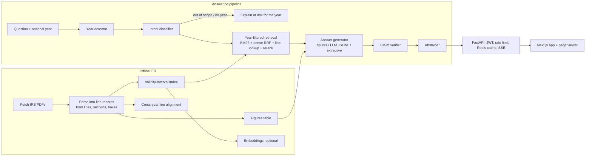

# TaxLens

[](https://github.com/MettukuruMrudul/taxlens/actions/workflows/ci.yml)

Tax-year-aware, citation-grounded question answering over IRS forms, instructions, and publications.

> TaxLens provides information from IRS publications for educational purposes only. It is not tax advice.

Ask "What's the standard deduction for a single filer?" and most RAG systems will happily quote whichever
year's Form 1040 their retriever happens to rank first. Tax text changes every year (amounts, line numbers,
whole lines), so a fluent answer from the wrong year is worse than no answer. TaxLens treats the tax year as a
hard constraint at every stage:

- **Year detection** reads the year from the question and handles the classic trap: the return you *file in*
  2024 is for tax year **2023**.
- **Validity-interval index**: each distinct passage is stored once with the range of tax years it applies to,
  and retrieval filters to the asked year *before* ranking, so another year's text cannot be returned.
- **Figures table**: dollar amounts like the standard deduction are extracted from the forms into a table and
  written into answers from there, never generated by a language model.
- **Cited, verified answers**: every answer sentence cites the passages it came from, and a verifier checks
  each claim (every number and date must appear in the cited text) before the sentence is shown.
- **Abstention**: when the evidence doesn't support an answer, TaxLens says so instead of guessing.
- **Source viewer**: each citation opens the exact IRS page with the cited words highlighted.

## Architecture



| Component | Module | What it does |
|---|---|---|
| C1 Fetcher | `taxlens/ingest/fetch.py` | Downloads the corpus from irs.gov/pub/irs-prior with checksums, retries, atomic writes |
| C2 Parser | `taxlens/ingest/parse.py` | PDF → form lines, form text, and instruction sections with bounding boxes (recursive XY-cut for columns) |
| C3 Interval index | `taxlens/index/intervals.py`, `build.py` | One unit per distinct text, valid for a contiguous range of tax years |
| C4 Figures | `taxlens/index/figures.py` | Standard deduction amounts per filing status and year, each traced to its source text |
| C5 Year detector | `taxlens/retrieve/yeardetect.py` | Explicit, tax-year, filing-year, and relative phrases |
| C6 Retrieval | `taxlens/retrieve/search.py`, `dense.py` | Year filter, BM25, optional bi-encoder with RRF, line lookup, optional cross-encoder rerank |
| C7 Generator | `taxlens/answer/generate.py` | Figures-table answers, streamed JSONL LLM answers with attribution repair, extractive fallback |
| C8 Verifier, abstainer | `taxlens/verify/` | Number/date grounding + lexical or NLI support; rule-based or trained abstention with selective-accuracy curve |
| C9 Intent | `taxlens/intent/` | Seven intent types; model selection by cross-validated macro-F1 |
| C10 Evaluation | `taxlens/eval/` | Retrieval and answer benchmarks, bootstrap CIs, McNemar tests, failure clusters, CI gate |
| C11 Line aligner | `taxlens/index/align.py` | Hungarian matching of form lines across adjacent years |
| C12 API | `taxlens/api/` | FastAPI with JWT auth, rate limiting, Redis cache with index-version invalidation, SSE streaming |
| C13 Frontend | `frontend/` | Next.js app: year selector, streamed answers, citation boxes, highlighted source pages, history, feedback |
| C14 Parse audit | `taxlens/eval/parse_audit.py` | Stratified human audit of parser coverage |
| C15 CI/CD | `.github/workflows/ci.yml`, `Dockerfile`s | Lint, tests, frontend build; weekly end-to-end evaluation with quality gate |
| C16 Tracing | `taxlens/tracing.py` | OpenTelemetry spans per stage (no-op when not configured) |

## Quickstart (Windows PowerShell)

Prerequisites: Python 3.11+, Docker Desktop, Node.js 22 LTS or newer (for the web app; Next.js 16 needs 20.9+).

```powershell
# 1. Infrastructure and Python environment
docker compose up -d                     # Postgres (pgvector) on 5433, Redis on 6379
python -m venv .venv
.\.venv\Scripts\Activate.ps1
pip install -r requirements.txt
copy .env.example .env
python -m pytest                         # unit tests, no database needed

# 2. Build the corpus and index (first time, or after parser changes)
python -m taxlens.ingest.fetch           # 36 IRS PDFs, tax years 2021-2024
python -m taxlens.migrate
python -m taxlens.ingest.run_parser
python -m taxlens.index.build            # interval index + figures table
python -m taxlens.index.align            # optional: cross-year line alignment

# 3. Ask from the terminal
python -m taxlens.ask "What is the standard deduction for a single filer for 2023?" --debug
python -m taxlens.ask "How did line 30 change from 2021 to 2022?"

# 4. Run the API (leave this window open)
uvicorn taxlens.api.main:app --reload --port 8000

# 5. Run the web app (in a second window)
cd frontend
copy .env.example .env.local
npm install
npm run dev                              # http://localhost:3000
```

Or run everything in containers after step 2: `docker compose --profile app up -d --build`.

## Configuration

All settings live in `.env` (see `.env.example`). The most important:

| Setting | Default | Meaning |
|---|---|---|
| `LLM_PROVIDER` | `none` | `none` quotes IRS text directly; `openai` works with OpenAI, vLLM, or Ollama via `LLM_BASE_URL`; `anthropic` uses the Anthropic API |
| `LLM_MODEL`, `LLM_API_KEY`, `LLM_BASE_URL` | | Model settings for the chosen provider |
| `EMBED_MODEL` | empty | e.g. `BAAI/bge-base-en-v1.5`; then run `python -m taxlens.index.embed` |
| `RERANK_MODEL`, `NLI_MODEL` | empty | Optional cross-encoders for re-ranking and claim verification |
| `JWT_SECRET` | empty (built-in dev secret) | Set a long random value anywhere beyond your own laptop; the API won't start with `ALLOW_DEV_TOKENS=false` and no secret |
| `ALLOW_DEV_TOKENS` | `true` | Enables the name-only sign-in; turn off in production |

Neural models need `pip install -r requirements-ml.txt` (downloads PyTorch).

## Evaluation

```powershell
python -m taxlens.eval.run_retrieval                 # naive RAG vs year-aware retrieval
python -m taxlens.eval.run_answers --gate            # full pipeline, answer-level metrics + quality gate
python -m taxlens.intent.train                       # intent model selection (macro-F1)
python -m taxlens.verify.abstain train eval/results/answer_features.jsonl
python -m taxlens.index.hard_negatives               # training triples with cross-year hard negatives
```

Reports are written to `eval/results/`. Every metric is reported with a 95% bootstrap confidence interval.

**About the numbers.** The 44-question benchmark (`eval/benchmark/seed_v0.jsonl`) and the 140-question intent
set (`eval/benchmark/intent_seed_v0.jsonl`) were drafted with Claude and are **not yet human-verified**. Treat
results on them as development measurements. Before quoting any figure (on a resume or elsewhere), verify the
gold answers by hand, expand the benchmark, and re-run.

| Metric | Target | Measured |
|---|---|---|
| Wrong-year answer rate | ≤ 3% | |
| Answer correctness (verified benchmark) | ≥ 85% | |
| Unsupported-claim rate | ≤ 5% | |
| Year-detection accuracy | ≥ 95% | |
| Intent macro-F1 | ≥ 0.85 | |
| Abstention AUROC | ≥ 0.90 | |
| Streaming time to first sentence (p50) | ≤ 1 s | |

## API

| Method | Path | Auth | Purpose |
|---|---|---|---|
| GET | `/health` | none | Liveness |
| GET | `/v1/meta` | none | Corpus years, enabled features |
| POST | `/v1/auth/dev-token` | none | Development sign-in |
| POST | `/v1/ask` | JWT | Full answer as JSON |
| POST | `/v1/ask/stream` | JWT | Server-sent events: `meta`, `sentence`, `abstain`, `done` |
| GET | `/v1/documents/{doc_id}` | JWT | Document metadata |
| GET | `/v1/documents/{doc_id}/pdf` | JWT | The source PDF |
| GET | `/v1/documents/{doc_id}/pages/{page}?boxes=` | JWT | Page image with highlighted boxes |
| GET | `/v1/history` | JWT | Your past questions |
| POST | `/v1/feedback` | JWT | Thumbs up/down with an optional comment |

Interactive docs: http://localhost:8000/docs. Errors are JSON: `{"error": "...", "code": "..."}`.

## Project layout

```
db/init/, db/migrations/   database schema
taxlens/ingest/            corpus definition, fetcher, PDF parser
taxlens/index/             interval index, figures, embeddings, line alignment, hard negatives
taxlens/retrieve/          year detection, BM25, hybrid retrieval, optional neural models
taxlens/intent/            intent classifier and model selection
taxlens/answer/            cited answer generation
taxlens/verify/            claim verification and abstention
taxlens/pipeline.py        the end-to-end answering pipeline (shared by CLI, API, and evaluation)
taxlens/api/               FastAPI app, auth, cache, page rendering
taxlens/eval/              parser audit, retrieval and answer benchmarks, quality gate
frontend/                  Next.js web app
eval/benchmark/            benchmark and intent data
eval/results/              evaluation reports
tests/                     pytest suite (in-memory corpus, no database needed)
```

## Scope and limits

- Corpus: Form 1040, Schedules 1, 2, 3, A, B, the Form 1040 and Schedule A instructions, and Publication 17,
  tax years 2021–2024. Federal individual income tax only; state taxes are out of scope.
- The figures table currently covers the standard deduction. Other year-specific amounts are answered from
  passages and checked by the verifier.
- TaxLens explains what IRS documents say. It does not give tax advice or prepare returns.
